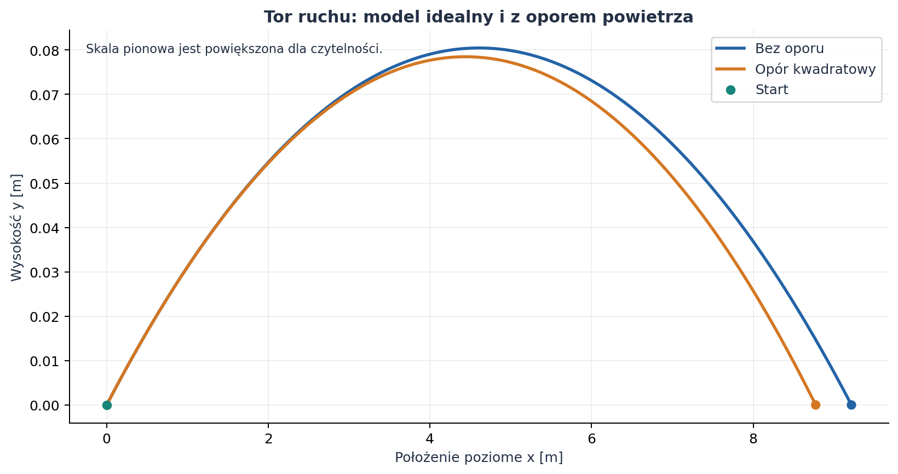
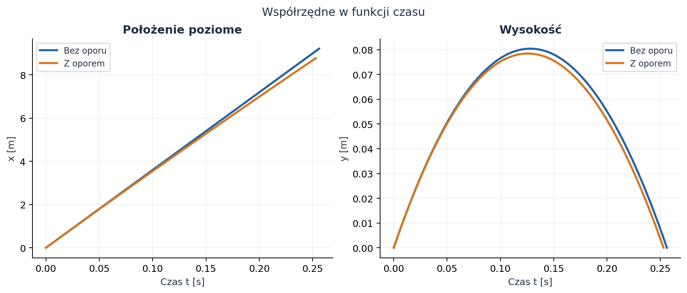
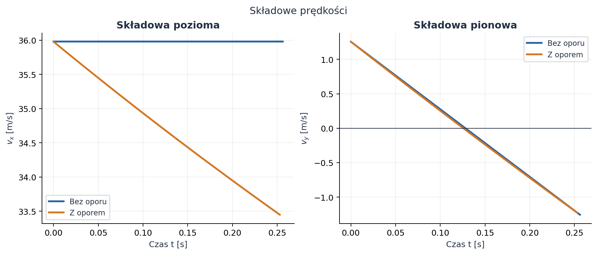
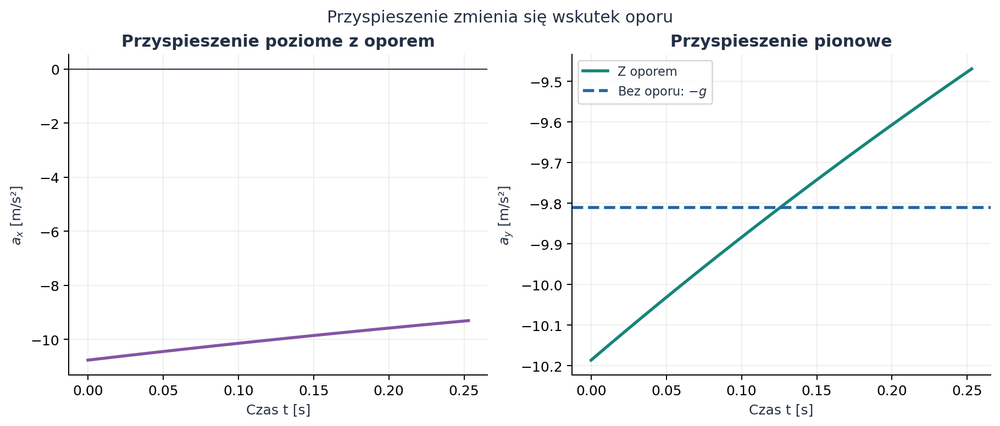
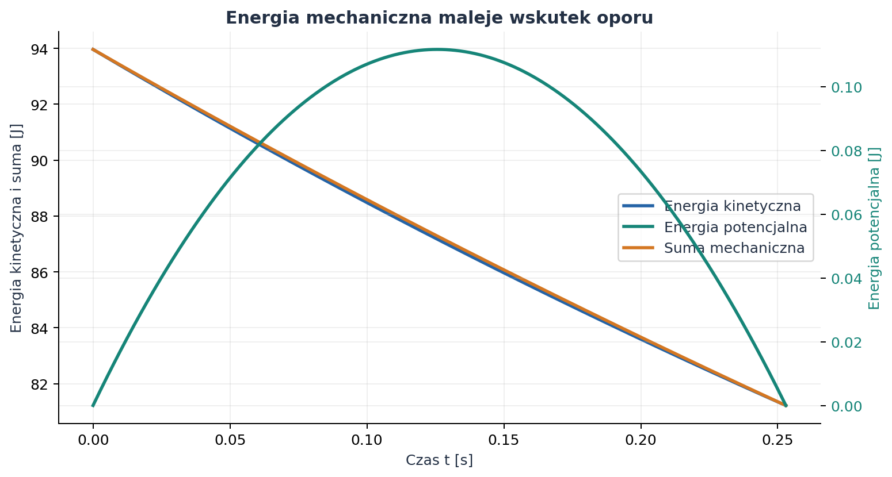
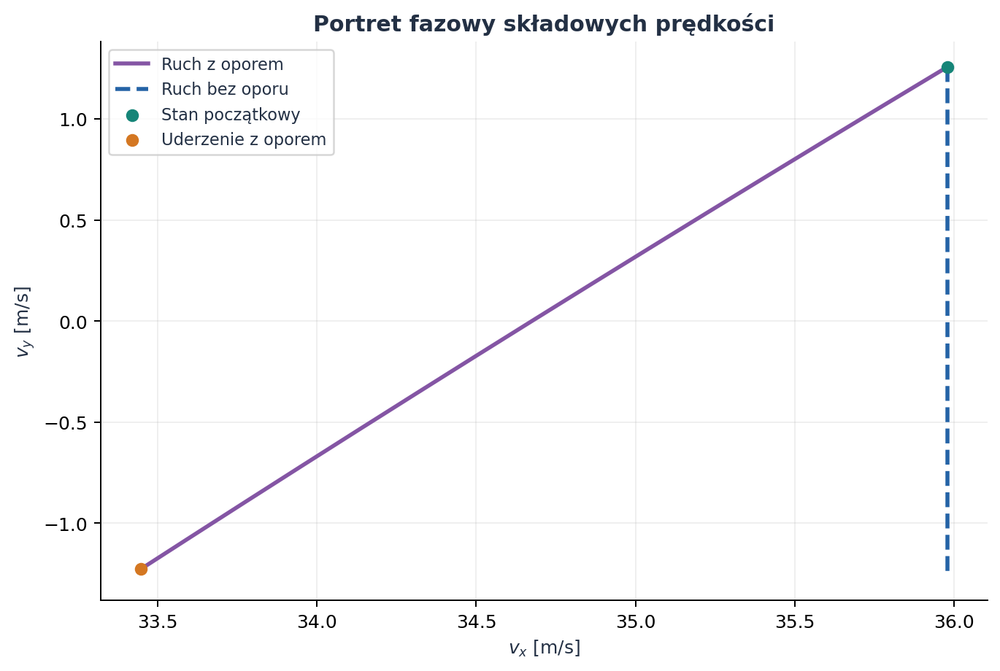

# Rzut ukośny — od ruchu idealnego do oporu powietrza

*Raport obliczeniowy z wyprowadzeniem równań, symulacją numeryczną i wykresami.*

**Temat:** ruch ciała rzuconego pod kątem do poziomu.  
**Dane początkowe:** prędkość $v_0=36\,\mathrm{m/s}$, kąt $\alpha=02^\circ=2^\circ$.  
**Metoda:** rozwiązanie analityczne bez oporu oraz numeryczne rozwiązanie równań ruchu z oporem kwadratowym.  
**Charakter wyników:** ilustracja modelowa, nie pomiar laboratoryjny.

Rzut ukośny można rozłożyć na dwa ruchy: poziomy i pionowy. Bez oporu powietrza są one niezależne, a tor jest parabolą. Opór zależy od wektora prędkości, więc w modelu z powietrzem składowe ruchu są sprzężone i równania rozwiązujemy numerycznie.

## Spis treści

1. [Cel i model fizyczny](#1-cel-i-model-fizyczny)
2. [Rzut bez oporu powietrza](#2-rzut-bez-oporu-powietrza)
3. [Rzut z oporem powietrza](#3-rzut-z-oporem-powietrza)
4. [Wyniki i interpretacja wykresów](#4-wyniki-i-interpretacja-wykresów)
5. [Metoda numeryczna i kontrola wyników](#5-metoda-numeryczna-i-kontrola-wyników)
6. [Kod i odtwarzanie wykresów](#6-kod-i-odtwarzanie-wykresów)
7. [Wnioski](#7-wnioski)

---

## 1. Cel i model fizyczny

### 1.1. Układ współrzędnych i założenia

Początek układu współrzędnych umieszczamy w punkcie wyrzutu. Oś $x$ jest pozioma i skierowana w kierunku rzutu, a oś $y$ pionowa i skierowana do góry. Podłoże jest poziome, więc punkt lądowania ma wysokość $y=0$.

Przyjmujemy następujące założenia:

- przyspieszenie grawitacyjne jest stałe i wynosi $g=9{,}81\,\mathrm{m/s^2}$;
- prędkość początkowa ma wartość $v_0=36\,\mathrm{m/s}$ i tworzy z poziomem kąt $2^\circ$;
- wiatr nie występuje, a gęstość powietrza i współczynnik oporu są stałe;
- ciało modelujemy jako kulę o stałej masie i średnicy;
- pomijamy obrót, siłę nośną, wypór powietrza i zmianę wysokości terenu;
- w modelu z oporem przyjmujemy opór kwadratowy, odpowiedni dla ruchu kuli w powietrzu w rozpatrywanym zakresie prędkości.

Zapis „02” interpretujemy jako kąt dwóch stopni. W obliczeniach numerycznych funkcje trygonometryczne otrzymują kąt w radianach:

$$
\alpha=2^\circ\frac{\pi}{180^\circ}
=0{,}0349066\,\mathrm{rad}.
$$



*Rysunek 1. Tor dla obu modeli. Skala pionowa została powiększona dla czytelności; różnice zasięgu są pokazane w skali poziomej.*

### 1.2. Symbole i jednostki

| Symbol | Znaczenie | Jednostka SI |
| :--- | :--- | :---: |
| $t$ | czas od wyrzutu | $\mathrm{s}$ |
| $x$, $y$ | położenie poziome i wysokość | $\mathrm{m}$ |
| $v_x$, $v_y$, $v$ | składowe i wartość prędkości | $\mathrm{m/s}$ |
| $a_x$, $a_y$ | składowe przyspieszenia | $\mathrm{m/s^2}$ |
| $m$ | masa ciała | $\mathrm{kg}$ |
| $g$ | przyspieszenie grawitacyjne | $\mathrm{m/s^2}$ |
| $\alpha$ | kąt wyrzutu | $\mathrm{rad}$ (w danych także $^\circ$) |
| $\rho$ | gęstość powietrza | $\mathrm{kg/m^3}$ |
| $C_D$ | bezwymiarowy współczynnik oporu | $1$ |
| $A$ | pole przekroju poprzecznego | $\mathrm{m^2}$ |
| $c$ | współczynnik w prawie oporu $F_D=c v^2$ | $\mathrm{kg/m}$ |
| $k=c/m$ | parametr w równaniu przyspieszenia oporu | $\mathrm{m^{-1}}$ |
| $H$, $R$ | maksymalna wysokość i zasięg | $\mathrm{m}$ |
| $E_k$, $E_p$, $E_m$ | energia kinetyczna, potencjalna i mechaniczna | $\mathrm{J}$ |

## 2. Rzut bez oporu powietrza

### 2.1. Rozłożenie prędkości początkowej

Prędkość początkową rozkładamy na składowe wzdłuż osi:

$$
v_{x0}=v_0\cos\alpha,
\qquad
v_{y0}=v_0\sin\alpha.
$$

Dla podanych danych:

$$
v_{x0}=36\cos(2^\circ)=35{,}9781\,\mathrm{m/s},
\qquad
v_{y0}=36\sin(2^\circ)=1{,}25638\,\mathrm{m/s}.
$$

### 2.2. Równania ruchu i ich wyprowadzenie

Bez oporu jedyną siłą działającą po wyrzucie jest ciężar $\vec F_g=(0,-mg)$. Z drugiej zasady Newtona $m\vec a=\vec F$ otrzymujemy:

$$
m\ddot{x}=0,
\qquad
m\ddot{y}=-mg,
$$

czyli

$$
\ddot{x}=0,
\qquad
\ddot{y}=-g.
$$

Całkujemy równania, korzystając z warunków początkowych $x(0)=y(0)=0$, $\dot{x}(0)=v_{x0}$ oraz $\dot{y}(0)=v_{y0}$:

$$
v_x(t)=v_{x0},
\qquad
v_y(t)=v_{y0}-gt,
$$

$$
x(t)=v_{x0}t=v_0\cos\alpha\,t,
\qquad
y(t)=v_{y0}t-\frac{1}{2}gt^2
=v_0\sin\alpha\,t-\frac{1}{2}gt^2.
$$

Aby otrzymać równanie toru, z pierwszego równania położenia wyznaczamy czas $t=x/(v_0\cos\alpha)$ i podstawiamy go do $y(t)$:

$$
y(x)=x\tan\alpha-\frac{g x^2}{2v_0^2\cos^2\alpha}.
$$

Jest to parabola. Jej kształt wynika z jednostajnego ruchu poziomego i jednostajnie przyspieszonego ruchu pionowego.

### 2.3. Czas lotu, wysokość i zasięg

W najwyższym punkcie toru pionowa składowa prędkości znika. Z równania $v_y(t)=v_{y0}-gt=0$ wynika:

$$
t_{\mathrm{wzn}}=\frac{v_0\sin\alpha}{g}.
$$

Ponieważ start i lądowanie są na tej samej wysokości, czas lotu jest dwukrotnością czasu wznoszenia:

$$
T=\frac{2v_0\sin\alpha}{g}.
$$

Maksymalną wysokość obliczamy, podstawiając $t_{\mathrm{wzn}}$ do $y(t)$:

$$
H=y(t_{\mathrm{wzn}})
=\frac{v_0^2\sin^2\alpha}{2g}.
$$

Zasięg to poziome położenie w chwili $T$:

$$
R=x(T)=v_0\cos\alpha\,T
=\frac{v_0^2\sin(2\alpha)}{g}.
$$

Wzory te zakładają jednakowy poziom wyrzutu i lądowania. Dla $\alpha=2^\circ$ model idealny daje:

| Wielkość | Wzór | Wynik |
| :--- | :--- | ---: |
| Czas wznoszenia $t_{\mathrm{wzn}}$ | $v_0\sin\alpha/g$ | $0{,}128071\,\mathrm{s}$ |
| Czas lotu $T$ | $2v_0\sin\alpha/g$ | $0{,}256143\,\mathrm{s}$ |
| Maksymalna wysokość $H$ | $v_0^2\sin^2\alpha/(2g)$ | $0{,}080453\,\mathrm{m}$ |
| Zasięg $R$ | $v_0^2\sin(2\alpha)/g$ | $9{,}21553\,\mathrm{m}$ |

### 2.4. Prędkość i przyspieszenie

Wartość prędkości w dowolnej chwili wynosi:

$$
v(t)=\sqrt{v_x^2+v_y^2}
=\sqrt{(v_0\cos\alpha)^2+(v_0\sin\alpha-gt)^2}.
$$

Bez oporu składowa pozioma prędkości jest stała. Pionowa maleje liniowo, przechodzi przez zero w najwyższym punkcie, a następnie staje się ujemna. Przyspieszenie jest stałe:

$$
a_x=0,
\qquad
a_y=-g=-9{,}81\,\mathrm{m/s^2}.
$$

## 3. Rzut z oporem powietrza

### 3.1. Prawo oporu kwadratowego

Dla poruszającej się względem powietrza kuli przyjmujemy wartość siły oporu:

$$
F_D=\frac{1}{2}\rho C_D A v^2,
\qquad
v=\sqrt{v_x^2+v_y^2}.
$$

Siła ma zwrot przeciwny do wektora prędkości, więc zapis wektorowy brzmi:

$$
\vec F_D=-\frac{1}{2}\rho C_D A\,v\,\vec v.
$$

Wprowadźmy skróty:

$$
c=\frac{1}{2}\rho C_D A,
\qquad
k=\frac{c}{m}=\frac{\rho C_D A}{2m}.
$$

Wtedy równanie Newtona przyjmuje postać

$$
m\frac{d\vec v}{dt}=m\vec g-cv\vec v,
\qquad
\frac{d\vec v}{dt}=\vec g-kv\vec v,
$$

gdzie $\vec g=(0,-g)$. Po rozpisaniu na osie otrzymujemy układ równań:

$$
\begin{aligned}
\dot{x}&=v_x, & \dot{y}&=v_y,\\
\dot{v}_x&=-k\sqrt{v_x^2+v_y^2}\,v_x,
&
\dot{v}_y&=-g-k\sqrt{v_x^2+v_y^2}\,v_y.
\end{aligned}
$$

Opór poziomy zależy również od pionowej składowej prędkości, ponieważ w obu równaniach występuje całkowita szybkość $v$. Dlatego w tym modelu nie można najpierw rozwiązać osi poziomej i pionowej niezależnie. Równania są nieliniowe; w ogólnym przypadku nie mają prostego rozwiązania elementarnego.

### 3.2. Parametry modelu oporu

Do obliczenia ilustracyjnego przyjmujemy kulę o parametrach zbliżonych do piłki:

| Parametr | Wartość | Jednostka SI |
| :--- | ---: | :---: |
| Masa $m$ | $0{,}145$ | $\mathrm{kg}$ |
| Średnica $d$ | $0{,}073$ | $\mathrm{m}$ |
| Gęstość powietrza $\rho$ | $1{,}225$ | $\mathrm{kg/m^3}$ |
| Współczynnik oporu $C_D$ | $0{,}47$ | $1$ |
| Przyspieszenie grawitacyjne $g$ | $9{,}81$ | $\mathrm{m/s^2}$ |

Dla kuli pole przekroju poprzecznego jest kołem:

$$
A=\pi\left(\frac{d}{2}\right)^2
=\pi(0{,}0365\,\mathrm{m})^2
=0{,}00418539\,\mathrm{m^2}.
$$

Wartości współczynników wynoszą:

$$
c=\frac{1}{2}\rho C_D A
=0{,}00120412\,\mathrm{kg/m},
\qquad
k=\frac{c}{m}
=0{,}00830944\,\mathrm{m^{-1}}.
$$

Są to założone parametry modelowe. Rzeczywiste $C_D$ może zależeć między innymi od kształtu, chropowatości, rotacji i liczby Reynoldsa.

### 3.3. Energia w modelu z oporem

Energia mechaniczna w polu grawitacyjnym jest sumą:

$$
E_m=\frac{1}{2}mv^2+mgy.
$$

Moc siły oporu, czyli tempo zmiany energii, to iloczyn skalarny siły i prędkości:

$$
\frac{dE_m}{dt}
=\vec F_D\cdot\vec v
=-cv^3
=-\frac{1}{2}\rho C_D A\,v^3\leq 0.
$$

Energia mechaniczna maleje; jest rozpraszana głównie w postaci ciepła w powietrzu. W modelu bez oporu suma energii kinetycznej i potencjalnej pozostaje stała.

## 4. Wyniki i interpretacja wykresów

Numeryczne rozwiązanie równań z oporem daje następujące przybliżone wyniki:

| Wielkość | Bez oporu | Z oporem kwadratowym |
| :--- | ---: | ---: |
| Czas lotu | $0{,}256143\,\mathrm{s}$ | $0{,}252954\,\mathrm{s}$ |
| Maksymalna wysokość | $0{,}080453\,\mathrm{m}$ | $0{,}078474\,\mathrm{m}$ |
| Zasięg | $9{,}21553\,\mathrm{m}$ | $8{,}77305\,\mathrm{m}$ |
| Szybkość przy lądowaniu | $35{,}9781\,\mathrm{m/s}$ | $33{,}4706\,\mathrm{m/s}$ |

W modelu idealnym prędkość przy lądowaniu ma taką samą wartość jak prędkość początkowa, ponieważ ciało wraca na tę samą wysokość, a energia mechaniczna jest zachowana. Z oporem ciało traci energię, ma mniejszą szybkość przy lądowaniu i osiąga krótszy zasięg.



*Rysunek 2. Położenie poziome rośnie w obu modelach. Przy oporze wysokość maksymalna i czas lotu są nieco mniejsze.*



*Rysunek 3. Bez oporu $v_x$ jest stałe, a $v_y$ zmienia się liniowo. Z oporem zmieniają się obie składowe prędkości.*



*Rysunek 4. Składowe przyspieszenia z oporem nie są stałe. Wznoszące ciało ma pionową siłę oporu skierowaną w dół, natomiast podczas opadania opór działa ku górze.*



*Rysunek 5. Energia kinetyczna i suma mechaniczna odczytywane są z lewej osi, energia potencjalna z prawej (oddzielne skale); suma maleje wskutek pracy siły oporu.*



*Rysunek 6. Portret fazowy przedstawia zależność składowej pionowej od poziomej. Linia przerywana pokazuje ruch idealny, krzywa ciągła — ruch z oporem.*

Przy małym kącie $2^\circ$ składowa początkowej prędkości skierowana do góry wynosi tylko około $1{,}26\,\mathrm{m/s}$, podczas gdy pozioma jest bliska $36\,\mathrm{m/s}$. Lot jest krótki i tor niski. Opór działa jednak przez cały czas i przede wszystkim zmniejsza składową poziomą, a więc zasięg. Na wykresie toru wysokość jest celowo przedstawiona w powiększeniu.

## 5. Metoda numeryczna i kontrola wyników

Stan układu zapisujemy jako wektor:

$$
\mathbf{s}(t)=
\begin{bmatrix}x&y&v_x&v_y\end{bmatrix}^{\mathsf T},
\qquad
\dot{\mathbf{s}}=\mathbf{f}(\mathbf{s}).
$$

Równania z oporem całkujemy klasyczną metodą Rungego–Kutty czwartego rzędu (RK4). Dla kroku $\Delta t$ i prawej strony $\mathbf{f}$ kolejne nachylenia są równe:

$$
\begin{aligned}
\mathbf{k}_1&=\mathbf{f}(\mathbf{s}_n),\\
\mathbf{k}_2&=\mathbf{f}\left(\mathbf{s}_n+\frac{\Delta t}{2}\mathbf{k}_1\right),\\
\mathbf{k}_3&=\mathbf{f}\left(\mathbf{s}_n+\frac{\Delta t}{2}\mathbf{k}_2\right),\\
\mathbf{k}_4&=\mathbf{f}\left(\mathbf{s}_n+\Delta t\,\mathbf{k}_3\right),
\end{aligned}
$$

$$
\mathbf{s}_{n+1}=\mathbf{s}_n+
\frac{\Delta t}{6}
(\mathbf{k}_1+2\mathbf{k}_2+2\mathbf{k}_3+\mathbf{k}_4).
$$

W skrypcie użyto $\Delta t=2\cdot10^{-4}\,\mathrm{s}$. Obliczenia kończą się, gdy wysokość po raz pierwszy spadnie poniżej zera. Położenie i czas uderzenia są interpolowane liniowo pomiędzy ostatnim punktem nad podłożem a pierwszym punktem pod nim, dzięki czemu punkt końcowy odpowiada $y=0$.

Model bez oporu nie wymaga całkowania numerycznego: jego rozwiązanie analityczne służy tu także jako porównanie. Wartości tabelaryczne są zaokrąglone; zmiana kroku całkowania może zmienić ostatnie cyfry wyniku modelu z oporem. Parametry oporu są przybliżone, więc wynik symulacji należy interpretować jako ilustrację modelu, a nie dokładną prognozę lotu dowolnego ciała.

## 6. Kod i odtwarzanie wykresów

Wykresy utworzono lokalnie za pomocą Pythona, NumPy i Matplotlib. Pełny skrypt jest również dostępny jako [`generuj_wykresy.py`](generuj_wykresy.py). W folderze tego raportu uruchom:

```bash
python -m pip install numpy matplotlib
python generuj_wykresy.py
```

Skrypt zapisuje sześć obrazów PNG do `files/rzut_ukosny/`. Poniżej znajduje się kompletny kod użyty do ich wygenerowania.

```python
# -*- coding: utf-8 -*-
"""Generate the figures accompanying raport.md.

Run from this directory with: python generuj_wykresy.py
Dependencies: numpy and matplotlib.
"""

from pathlib import Path

import matplotlib

matplotlib.use("Agg")
import matplotlib.pyplot as plt
import numpy as np


OUT = Path(__file__).resolve().parent / "files" / "rzut_ukosny"
OUT.mkdir(parents=True, exist_ok=True)

V0 = 36.0
ALPHA_DEG = 2.0
ALPHA = np.deg2rad(ALPHA_DEG)
G = 9.81
MASS = 0.145
DIAMETER = 0.073
RHO = 1.225
CD = 0.47
AREA = np.pi * (DIAMETER / 2.0) ** 2
DRAG_FACTOR = RHO * CD * AREA / (2.0 * MASS)
DT = 2.0e-4

BLUE, ORANGE, GREEN, PURPLE, INK = (
    "#2463A6",
    "#D47722",
    "#168578",
    "#8455A4",
    "#233044",
)
plt.rcParams.update(
    {
        "font.family": "DejaVu Sans",
        "font.size": 10,
        "axes.titlesize": 12,
        "axes.titleweight": "bold",
        "axes.labelcolor": INK,
        "text.color": INK,
        "axes.spines.top": False,
        "axes.spines.right": False,
        "axes.grid": True,
        "grid.alpha": 0.2,
        "lines.linewidth": 2.2,
        "figure.facecolor": "white",
        "savefig.facecolor": "white",
    }
)


def derivative(state):
    x, y, vx, vy = state
    speed = np.hypot(vx, vy)
    return np.array(
        [
            vx,
            vy,
            -DRAG_FACTOR * speed * vx,
            -G - DRAG_FACTOR * speed * vy,
        ]
    )


def simulate_with_drag():
    """Integrate motion with RK4 and interpolate the ground impact."""
    state = np.array(
        [0.0, 0.0, V0 * np.cos(ALPHA), V0 * np.sin(ALPHA)]
    )
    times = [0.0]
    states = [state.copy()]

    for _ in range(10000):
        previous = state.copy()
        k1 = derivative(state)
        k2 = derivative(state + 0.5 * DT * k1)
        k3 = derivative(state + 0.5 * DT * k2)
        k4 = derivative(state + DT * k3)
        state = state + (DT / 6.0) * (k1 + 2 * k2 + 2 * k3 + k4)
        time = times[-1] + DT

        if state[1] < 0.0:
            fraction = previous[1] / (previous[1] - state[1])
            state = previous + fraction * (state - previous)
            time = times[-1] + fraction * DT
            state[1] = 0.0
            times.append(time)
            states.append(state.copy())
            break

        times.append(time)
        states.append(state.copy())
    else:
        raise RuntimeError("Ground impact was not reached within the time limit.")

    return np.asarray(times), np.asarray(states)


def save(fig, filename):
    fig.savefig(OUT / filename, dpi=180, bbox_inches="tight")
    plt.close(fig)


def main():
    vx0 = V0 * np.cos(ALPHA)
    vy0 = V0 * np.sin(ALPHA)
    flight_time_ideal = 2.0 * vy0 / G
    time_ideal = np.linspace(0.0, flight_time_ideal, 500)
    x_ideal = vx0 * time_ideal
    y_ideal = vy0 * time_ideal - 0.5 * G * time_ideal**2
    vx_ideal = np.full_like(time_ideal, vx0)
    vy_ideal = vy0 - G * time_ideal

    time_drag, state_drag = simulate_with_drag()
    x_drag, y_drag, vx_drag, vy_drag = state_drag.T
    speed_drag = np.hypot(vx_drag, vy_drag)
    ax_drag = -DRAG_FACTOR * speed_drag * vx_drag
    ay_drag = -G - DRAG_FACTOR * speed_drag * vy_drag
    kinetic_drag = 0.5 * MASS * speed_drag**2
    potential_drag = MASS * G * y_drag
    energy_drag = kinetic_drag + potential_drag

    fig, ax = plt.subplots(figsize=(9, 4.7), layout="constrained")
    ax.plot(x_ideal, y_ideal, color=BLUE, label="Bez oporu")
    ax.plot(x_drag, y_drag, color=ORANGE, label="Opór kwadratowy")
    ax.scatter([0.0], [0.0], color=GREEN, zorder=3, label="Start")
    ax.scatter([x_ideal[-1], x_drag[-1]], [0.0, 0.0],
               color=[BLUE, ORANGE], zorder=3, s=35)
    ax.set(
        xlabel="Położenie poziome x [m]",
        ylabel="Wysokość y [m]",
        title="Tor ruchu: model idealny i z oporem powietrza",
    )
    ax.legend()
    ax.text(
        0.02,
        0.97,
        "Skala pionowa jest powiększona dla czytelności.",
        transform=ax.transAxes,
        va="top",
        fontsize=9,
        color=INK,
    )
    save(fig, "tor_ruchu.png")

    fig, axes = plt.subplots(1, 2, figsize=(10, 4.2), layout="constrained")
    axes[0].plot(time_ideal, x_ideal, color=BLUE, label="Bez oporu")
    axes[0].plot(time_drag, x_drag, color=ORANGE, label="Z oporem")
    axes[0].set(xlabel="Czas t [s]", ylabel="x [m]", title="Położenie poziome")
    axes[0].legend(fontsize=9)
    axes[1].plot(time_ideal, y_ideal, color=BLUE, label="Bez oporu")
    axes[1].plot(time_drag, y_drag, color=ORANGE, label="Z oporem")
    axes[1].set(xlabel="Czas t [s]", ylabel="y [m]", title="Wysokość")
    axes[1].legend(fontsize=9)
    fig.suptitle("Współrzędne w funkcji czasu")
    save(fig, "polozenie_czas.png")

    fig, axes = plt.subplots(1, 2, figsize=(10, 4.2), layout="constrained")
    axes[0].plot(time_ideal, vx_ideal, color=BLUE, label="Bez oporu")
    axes[0].plot(time_drag, vx_drag, color=ORANGE, label="Z oporem")
    axes[0].set(xlabel="Czas t [s]", ylabel="$v_x$ [m/s]", title="Składowa pozioma")
    axes[0].legend(fontsize=9)
    axes[1].plot(time_ideal, vy_ideal, color=BLUE, label="Bez oporu")
    axes[1].plot(time_drag, vy_drag, color=ORANGE, label="Z oporem")
    axes[1].axhline(0.0, color=INK, lw=0.8)
    axes[1].set(xlabel="Czas t [s]", ylabel="$v_y$ [m/s]", title="Składowa pionowa")
    axes[1].legend(fontsize=9)
    fig.suptitle("Składowe prędkości")
    save(fig, "predkosc_czas.png")

    fig, axes = plt.subplots(1, 2, figsize=(10, 4.2), layout="constrained")
    axes[0].plot(time_drag, ax_drag, color=PURPLE)
    axes[0].axhline(0.0, color=INK, lw=0.8)
    axes[0].set(xlabel="Czas t [s]", ylabel="$a_x$ [m/s²]",
                title="Przyspieszenie poziome z oporem")
    axes[1].plot(time_drag, ay_drag, color=GREEN, label="Z oporem")
    axes[1].axhline(-G, color=BLUE, ls="--", label="Bez oporu: $-g$")
    axes[1].set(xlabel="Czas t [s]", ylabel="$a_y$ [m/s²]",
                title="Przyspieszenie pionowe")
    axes[1].legend(fontsize=9)
    fig.suptitle("Przyspieszenie zmienia się wskutek oporu")
    save(fig, "przyspieszenie_czas.png")

    fig, ax = plt.subplots(figsize=(8.5, 4.5), layout="constrained")
    ax_potential = ax.twinx()
    kinetic_line, = ax.plot(
        time_drag, kinetic_drag, color=BLUE, label="Energia kinetyczna"
    )
    potential_line, = ax_potential.plot(
        time_drag, potential_drag, color=GREEN, label="Energia potencjalna"
    )
    energy_line, = ax.plot(
        time_drag, energy_drag, color=ORANGE, label="Suma mechaniczna"
    )
    ax.set(
        xlabel="Czas t [s]",
        ylabel="Energia kinetyczna i suma [J]",
        title="Energia mechaniczna maleje wskutek oporu",
    )
    ax_potential.set_ylabel("Energia potencjalna [J]", color=GREEN)
    ax_potential.tick_params(axis="y", labelcolor=GREEN)
    ax.legend(
        [kinetic_line, potential_line, energy_line],
        [line.get_label() for line in (kinetic_line, potential_line, energy_line)],
        loc="center right",
    )
    save(fig, "energia.png")

    fig, ax = plt.subplots(figsize=(7.5, 5.0), layout="constrained")
    ax.plot(vx_drag, vy_drag, color=PURPLE, label="Ruch z oporem")
    ax.plot(vx_ideal, vy_ideal, color=BLUE, ls="--", label="Ruch bez oporu")
    ax.scatter([vx0], [vy0], color=GREEN, zorder=3, label="Stan początkowy")
    ax.scatter([vx_drag[-1]], [vy_drag[-1]], color=ORANGE, zorder=3,
               label="Uderzenie z oporem")
    ax.set(
        xlabel="$v_x$ [m/s]",
        ylabel="$v_y$ [m/s]",
        title="Portret fazowy składowych prędkości",
    )
    ax.legend(fontsize=9)
    save(fig, "portret_fazowy.png")

    ideal_range = x_ideal[-1]
    ideal_height = float(np.max(y_ideal))
    impact_speed = float(speed_drag[-1])
    dissipated = float(energy_drag[0] - energy_drag[-1])
    print(f"v_x0 = {vx0:.6f} m/s; v_y0 = {vy0:.6f} m/s")
    print(f"Pole przekroju A = {AREA:.8f} m^2")
    print(f"Parametr oporu k = {DRAG_FACTOR:.8f} 1/m")
    print(f"Bez oporu: czas lotu = {flight_time_ideal:.6f} s")
    print(f"Bez oporu: zasięg = {ideal_range:.6f} m; h_max = {ideal_height:.6f} m")
    print(
        f"Z oporem: czas lotu = {time_drag[-1]:.6f} s; "
        f"zasięg = {x_drag[-1]:.6f} m; h_max = {np.max(y_drag):.6f} m"
    )
    print(f"Z oporem: prędkość przy uderzeniu = {impact_speed:.6f} m/s")
    print(f"Utrata energii mechanicznej = {dissipated:.6f} J")
    print(f"Zapisano 6 wykresów w: {OUT}")


if __name__ == "__main__":
    main()
```

## 7. Wnioski

1. Dla rzutu bez oporu składowe ruchu rozwiązują się niezależnie: pozioma prędkość jest stała, a pionowe przyspieszenie wynosi $-g$. Eliminacja czasu prowadzi do parabolicznego równania toru.
2. Przy $v_0=36\,\mathrm{m/s}$ i $\alpha=2^\circ$ model idealny przewiduje zasięg około $9{,}22\,\mathrm{m}$ i maksymalną wysokość około $0{,}0805\,\mathrm{m}$.
3. Opór kwadratowy sprzęga składowe prędkości, zmniejsza energię mechaniczną i — dla przyjętych parametrów kuli — skraca zasięg do około $8{,}77\,\mathrm{m}$.
4. Numeryczna metoda RK4 pozwala obliczyć tor mimo braku prostego rozwiązania analitycznego. Wartości z oporem zależą od przyjętych parametrów i uproszczeń modelu.
